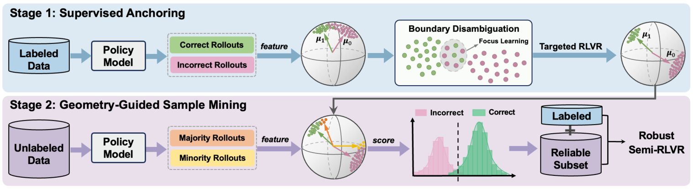

# GeoMin: Data-Efficient Semi-Supervised RLVR via Geometric Distribution Modeling

<p align="center">
  <a href="https://arxiv.org/abs/2606.04516"></a>
  <a href="LICENSE"></a>
  <a href="https://github.com/ZJU-DIG/DE-Venus"></a>
</p>

## Overview

This repository provides the official implementation of our KDD 2027 paper [GeoMin](https://arxiv.org/abs/2606.04516).

Our key insight is that correct and incorrect reasoning rollouts exhibit distinct directional distributions in the model's representation space. GeoMin first fits von Mises-Fisher distributions on a small labeled set and sharpens their separation through boundary-focused advantage reweighting. It then uses these geometric priors to assess pseudo-label reliability and adaptively mine unlabeled samples for semi-supervised RLVR. This enables GeoMin to surpass fully supervised vanilla GRPO with only 10% of the annotations.

<p align="center">
  <a href="assets/figures/geomin_overview.png"></a>
</p>
<p align="center"><sub>Stage 1: supervised anchoring. Stage 2: geometry-guided sample mining for semi-supervised RLVR.</sub></p>

## Getting Started

### Installation

Our implementation is based on **verl 0.7.0.dev**. Refer to the [installation guide](docs/start/install.rst) for the base FSDP + vLLM environment, then run the following commands from the repository root:

```bash
conda create -n geomin python=3.12
conda activate geomin

pip3 install -e ".[vllm]"
pip3 install math-verify scipy scikit-learn fire
```

### Preparation

The processed training and evaluation datasets are provided in `data/`, ready to use. Download the default model, [Qwen3-8B-Base](https://huggingface.co/Qwen/Qwen3-8B-Base), to the model path configured in `Weakly_Supervised/scripts/semi_run_geomin_s1.sh` and proceed to the two-stage training below.

### Training

Configure the model, data, and output paths in the launch scripts, then run them in order for supervised anchoring and semi-supervised RLVR training:

```bash
bash Weakly_Supervised/scripts/semi_run_geomin_s1.sh  # Supervised anchoring on labeled data
bash Weakly_Supervised/scripts/semi_run_geomin_s2.sh  # Mine unlabeled data and train semi-supervised RLVR
```

### Evaluation

In `Weakly_Supervised/eval_scripts/eval.sh`, configure the local paths, use `TASK` to choose the benchmark (`math`, `arc_c`, `gpqa`, or `mmlu_pro`) and `GLOBAL_STEPS` to select checkpoints by their training steps. Then run:

```bash
bash Weakly_Supervised/eval_scripts/eval.sh
```

## Acknowledgments

GeoMin has been integrated into [DE-Venus](https://github.com/ZJU-DIG/DE-Venus), our framework for data-efficient LLM post-training. Our implementation builds on [verl](https://github.com/volcengine/verl), [vLLM](https://github.com/vllm-project/vllm), and [Math-Verify](https://github.com/huggingface/Math-Verify). We thank these projects and the open-source community.

## Citation

If you find this work useful, please consider citing our paper:

```bibtex
@article{zhu2026geomin,
  title   = {GeoMin: Data-Efficient Semi-Supervised RLVR via Geometric Distribution Modeling},
  author  = {Zhu, Guangcheng and Yang, Shenzhi and Wang, Haobo and Zheng, Xing and Ma, Yingfan and Feng, Xuening and Chen, Zhongqi and Tang, Kai and Zang, Zhengqing and Song, Bowen and Wang, Weiqiang and Chen, Gang},
  journal = {arXiv preprint arXiv:2606.04516},
  year    = {2026},
  doi     = {10.48550/arXiv.2606.04516},
  url     = {https://arxiv.org/abs/2606.04516}
}
```

## Contact

If you have any questions, please feel free to contact the authors. Guangcheng Zhu: [zhuguangcheng@zju.edu.cn](mailto:zhuguangcheng@zju.edu.cn).
